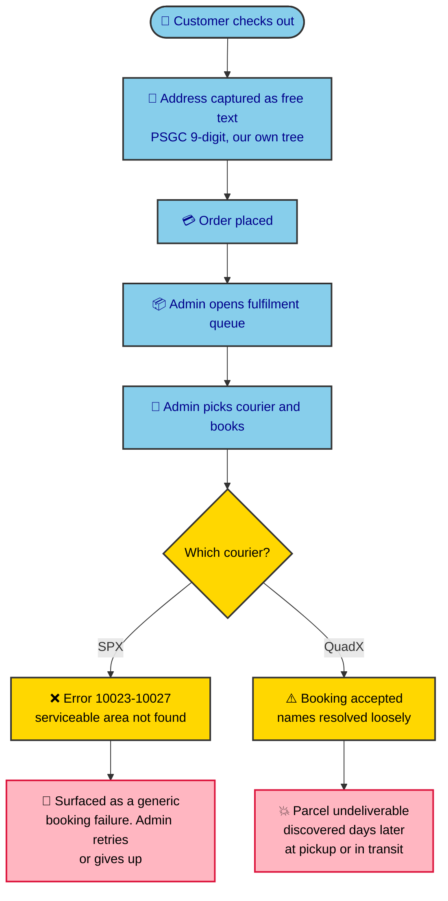
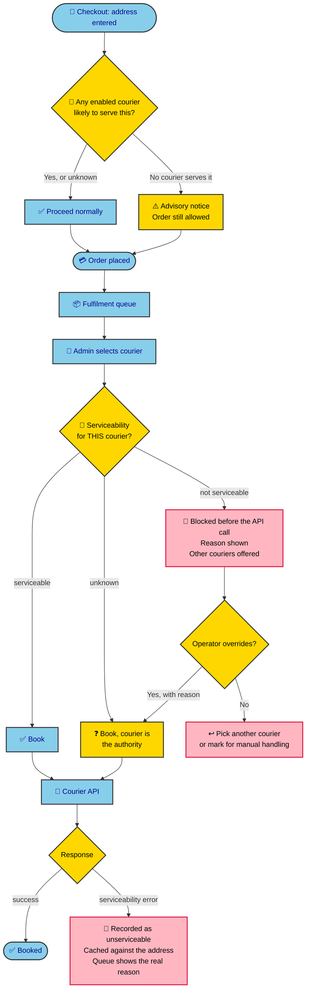
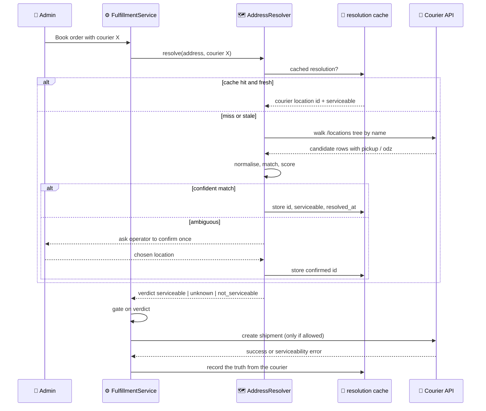
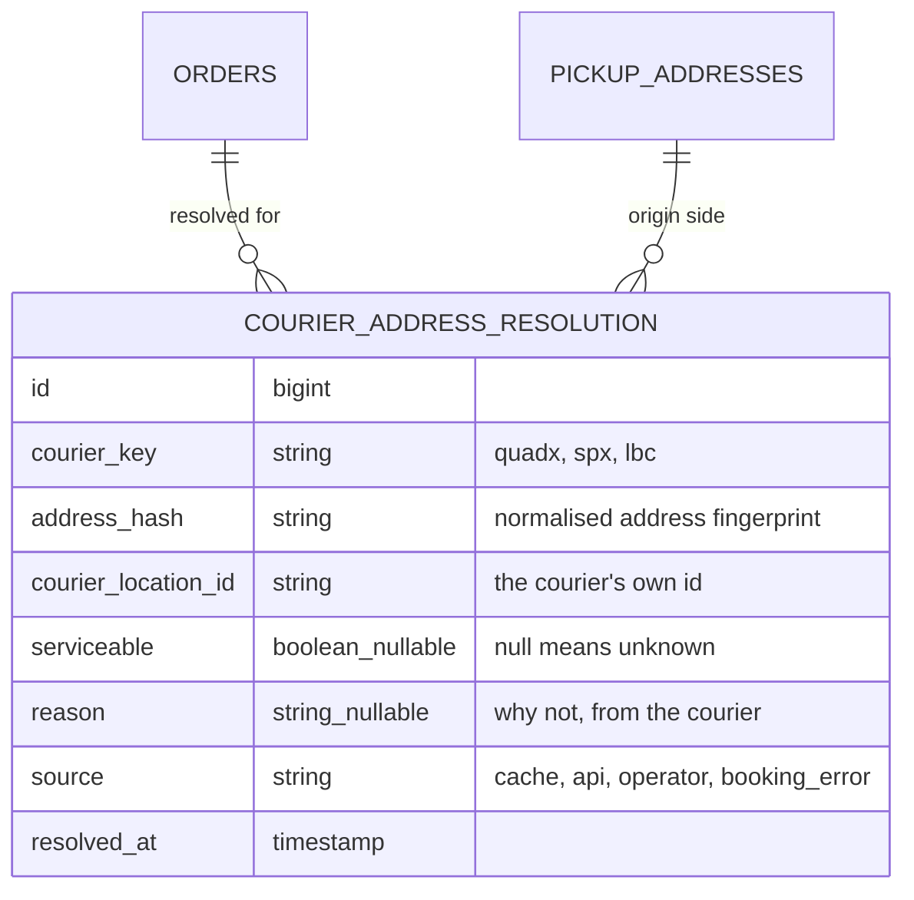

# Courier serviceability and address mapping

Status: design, not implemented. Raised 2026-08-11 after QuadX live credentials landed.

## The question

> "There are serviceable and non serviceable areas of our couriers, QuadX and SPX. Soon LBC and perhaps other courier services. What is the best workflow if the customer's address is non serviceable? Does the fulfilment block the pickup? Do we block the ordering from the start? Does our fulfilment API fetch the serviceable and non serviceable areas? For QuadX right now, we push our details, but not mapped. Which means we might hit a non serviceable area and still book the pickup."

The last sentence is correct. This document establishes what is true today, answers each question, and proposes a workflow.

## What is true today, measured

| Fact | Evidence |
|---|---|
| We have no serviceability concept at all | Zero matches for `serviceab`, `odz`, `deliverab` across `app/`, `extensions/`, `database/` |
| SPX rejects at booking time | `docs/spx/guide.md` error codes **10023 to 10027** and **10062 to 10066**: "delivery address does not found in ops serviceable area", "pickup address does not found in basic serviceable area" |
| We handle none of those codes | `SpxFulfillment` handles 1000, 1001, 1085, 1133, 1145, 13002, 13251, 1432. None of the 1002x or 1006x range |
| QuadX publishes serviceability | Every `/locations/*` row carries `pickup: true\|false` and `odz` |
| We never read it | No call to `/locations/*` anywhere in the codebase |
| We send names, not ids | `QuadXFulfillment::buildPayload()` sends `city`, `barangay`, `state` as strings |
| Our geo zones are empty | 3 rows, **0 entries each**, one literally named `dsfsdf` |
| PSGC codes do not map | 0 of 17 NCR cities align. Ours `137405000` (San Juan), theirs `1381400000`. Two PSGC generations |
| Names do map, mostly | 1,000 of 1,004 sampled cities match by normalised name (99.6%). Barangays unmeasured |

So the failure mode is real and asymmetric: **SPX fails loudly at booking with an error we do not recognise, and QuadX may accept a booking we cannot fulfil.**

## Today's path, and where it breaks



The customer has already paid before anyone discovers the address cannot be served.

## The four questions, answered

### 1. Does fulfilment block the pickup?

**No, and today it cannot.** SPX blocks itself by returning an error, but we do not read that error as "unserviceable", so the operator sees a generic failure with no guidance. QuadX does not appear to block at all, because we send loose strings that its resolver accepts.

### 2. Do we block the ordering from the start?

**No, and we should not block outright.** Serviceability is not a property of an address. It is a property of **(address x courier)**. An address QuadX will not serve may be fine for LBC, and a merchant may still ship it by other means. Blocking the sale at checkout throws away revenue that another courier could have earned.

The right shape is **warn at checkout, block at booking**, with a deliberate operator override.

### 3. Does our fulfilment API fetch serviceable areas?

**No.** And the two couriers differ in what is even possible:

| Courier | Serviceability source | Available before booking? |
|---|---|---|
| **QuadX** | `/locations/*` rows carry `pickup` and `odz` | **Yes**, queryable and cacheable |
| **SPX** | Error codes 10023-10027, 10062-10066 at booking | **No**, only discovered by attempting |
| **LBC** (future) | Unknown | To be established |

This asymmetry must be a first-class part of the design. Any interface that assumes every courier can answer "do you serve this address" in advance will be wrong for SPX on day one.

### 4. Should we map our locations to the couriers'?

**Yes, but inside each adapter, and not by code arithmetic.**

An earlier draft of this document called PSGC mapping "impossible". That was overstated and is corrected here. What is proven is narrower: **no arithmetic conversion exists** between our 9-digit codes and QuadX's 10-digit ones, because NCR was renumbered between PSGC generations (0 of 17 cities align). A crosswalk table is entirely buildable: 1,632 city rows, of which 99.6% resolve automatically by normalised name.

The more important correction is about where any of this belongs. **We do not persist a PSGC code anywhere.** Orders and customer addresses store plain strings (`city=Caloocan`, `barangay=Baesa`, `state=Metro Manila`); only `country_id` is a foreign key. PSGC exists in this codebase solely as the parent/child scaffolding behind the address picker. It is not part of the data model and never reaches a courier.

So the question is not "align our locational database with the couriers". That would drag vendor concerns into core master data. PSGC stays as the neutral, government-owned, courier-independent spine, and **each courier's mapping lives inside that courier's own adapter**, cached per address, invisible to core.

Adopting a courier's tree as our master is explicitly rejected: their ids would become our primary keys, and the platform would break the day that courier is dropped or renumbers.

## Proposed workflow

Three checkpoints, escalating in cost and authority.



### Why checkout only warns

A hard block at checkout is wrong for four reasons:

1. Serviceability is per courier, and the shopper does not choose the courier.
2. A merchant may ship an "unserviceable" parcel by other means, including their own rider.
3. Our data is one PSGC generation old, so a false negative would refuse a real sale.
4. SPX cannot answer in advance at all, so checkout would be guessing for half the fleet.

The advisory should be honest and quiet: the address may need manual arrangement, not "we cannot ship to you".

### Why booking blocks

By booking time the courier is chosen, so the question is answerable. Blocking here costs nothing but a courier switch, and it converts a failure discovered days later into a decision made in two seconds.

The override matters: the operator may know something the data does not, and refusing them entirely would make the feature something to work around.

## Resolution and caching



The courier's own response is always the final authority. Cached verdicts are a prediction; the API is the fact, and a serviceability error must write back into the cache so the same mistake is not repeated.

## Data model

Extension-owned, following the rule that core carries no columns for a module.



Keying on an **address fingerprint** rather than a customer address id means the resolution is reused across every order to the same place, and survives a customer editing an unrelated field.

`serviceable` is deliberately **nullable**. Three states, not two: yes, no, and we genuinely cannot know. SPX is permanently in the third state until it books.

## The interface change

`CourierFulfillmentInterface` gains one method:

```php
public function checkServiceability(Address $address): ServiceabilityVerdict;
```

Returning one of `serviceable`, `not_serviceable(reason)`, or `unknown`. The default implementation returns `unknown`, so:

- **QuadX** overrides it, walking its cached location tree and reading `pickup` and `odz`.
- **SPX** does not override it. It returns `unknown`, and contributes truth only by mapping its 10023-10027 and 10062-10066 error codes to `not_serviceable` after a booking attempt.
- **LBC** and anything future implements whichever half it can support.

This is the part that keeps the design honest: a courier that cannot predict is not forced to pretend.

## Work, in order of value

| # | Work | Why first |
|---|---|---|
| 1 | Map SPX error codes 10023-10027 and 10062-10066 to a named unserviceable failure | Cheapest. Turns an existing silent failure into a clear message today. No new schema |
| 2 | `ServiceabilityVerdict` and the interface default of `unknown` | The seam everything else hangs from |
| 3 | QuadX location cache and resolver, with the confirm-once flow | Where the real prevention comes from |
| 4 | Block at booking, with override and reason | The operator-visible behaviour |
| 5 | Write back booking-time serviceability errors into the cache | Makes the system learn from every failure |
| 6 | Checkout advisory | Last, because it is the least reliable signal and the most visible to shoppers |

Item 1 is worth doing on its own even if nothing else follows.

## Open questions for the owner

1. **Barangay coverage is unmeasured.** City names match at 99.6%, but barangays are where matching usually breaks, and there are 42,000 of them. Worth measuring for the cities you actually ship to before committing to name-based resolution.
2. **Does QuadX reject an unserviceable booking, or accept it?** Untested, because testing means creating a real waybill to a deliberately bad address. Worth asking them directly rather than probing production.
3. **Adopt QuadX ids, or keep resolving?** Storing their id is exact and free of drift, but couples an address to one courier. Resolving each time stays generic but depends on name matching.
4. **What should a shopper actually see?** The advisory wording is a commercial decision, not a technical one.
5. **Our PSGC data is one generation behind**, missing NIR (2024) and using the pre-BARMM numbering. Updating it is independent of this work but affects the same matching.
